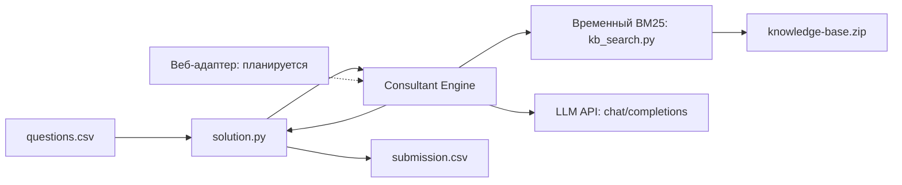

# MTS EnergyTool AI Consultant

AI-консультант для B2B-клиентов EnergyTool по кейсу МТС на [Changellenge >> Hack&Change 2026](https://changellenge.com/championships/khakaton-hack-change-2026/). Проект команды «Рено Логан 2007» готовит ответы по предоставленной базе знаний и учитывает историю короткого диалога.

## Архитектура



Реализованы конкурсный CSV-адаптер, общий Consultant Engine, клиент LLM API и временный поиск BM25 по Markdown и текстовым файлам. Движок отделяет найденные документы от системных инструкций и возвращает безопасный ответ при отсутствии контекста или ошибке. Адаптер сохраняет порядок ID и обрабатывает отдельные сбои без остановки остальных вопросов.

Основной RAG находится на ревью в [PR #54](https://github.com/sl4dk1y/MTS-EnergyTool-AI-Consultant/pull/54); в текущей `main` применяется временный BM25. Веб-интерфейс, backend, сбор заявок и интеграция с сайтом находятся в разработке. Docker-запуск, реальный API и полный конкурсный запуск пока не подтверждены.

## Структура

```text
.
├── solution.py              # конкурсный адаптер
├── consultant_engine.py     # движок консультации
├── consultant_contracts.py  # внутренние контракты
├── kb_search.py             # временный BM25
├── llm_client.py            # клиент LLM API
├── requirements.txt         # текущий адаптер без внешних зависимостей
├── tests/                   # unit-тесты
├── tools/                   # локальная оценка поиска
├── docs/                    # документация проекта
└── .github/workflows/        # CI
```

## Локальный запуск

Нужны Python 3.9 или 3.11, разрешённая локальная база `knowledge-base.zip`, входной `questions.csv` и доступ к предусмотренному API модели. Базу и входной файл поместите в каталог `data/` или укажите его через `DATA_DIR`. Ключ храните только в окружении. Пример для оболочки Unix:

```bash
export DATA_DIR="data"
export LLM_BASE_URL="<адрес API>"
export LLM_API_KEY="<ключ API>"
export LLM_MODEL="<идентификатор модели>"
python solution.py
```

Вместо `LLM_BASE_URL` и `LLM_API_KEY` поддерживаются `OPENAI_BASE_URL` и `OPENAI_API_KEY`; модель также может задаваться через `OPENAI_MODEL` или `GEN_MODEL`. `RETRIEVER=bm25` принудительно выбирает временный поиск. Остальные параметры описаны в [документации движка](docs/ENGINE.md). Не запускайте реальные запросы без разрешения и действующей конфигурации организаторов.

`questions.csv` содержит заголовки `id,question`; поле вопроса может включать многострочную историю диалога. Скрипт создаёт `submission.csv` в текущем рабочем каталоге с колонками `id,answer`, сохраняя порядок идентификаторов. CSV поддерживает кавычки, запятые и переносы строк. Ответ ограничен 10 000 символами.

## Проверка

```bash
python -m unittest discover -s tests -v
```

Тесты используют синтетические данные и подменяют сетевые вызовы. Наличие проходящих unit-тестов не подтверждает работу платформы или качество ответов реальной модели.

## Документация и участие

[Архитектура](docs/ARCHITECTURE.md) · [Требования](docs/REQUIREMENTS.md) · [Конкурсный регламент](docs/COMPETITION.md) · [Consultant Engine](docs/ENGINE.md)

Правила работы команды — в [CONTRIBUTING.md](CONTRIBUTING.md), защита данных — в [SECURITY.md](SECURITY.md), участники — в [CONTRIBUTORS.md](CONTRIBUTORS.md). Не добавляйте в публичный Git закрытые материалы организаторов, ключи, персональные данные и производные индексы.

## Лицензия

Собственный исходный код проекта распространяется по Apache License 2.0; полный текст приведён в [LICENSE](LICENSE). Уведомления об авторстве и сторонних материалах находятся в [NOTICE](NOTICE). Лицензия проекта не заменяет условия использования сторонних компонентов и материалов организаторов.
