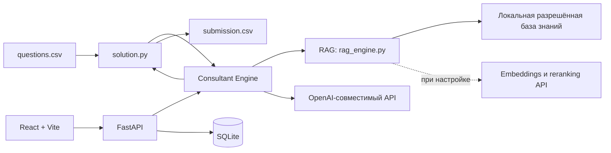

# MTS EnergyTool AI Consultant

Веб- и конкурсный прототип консультанта EnergyTool. Конкурсный запуск читает вопросы из `questions.csv` и записывает ответы в `submission.csv`. Веб-прототип использует тот же Consultant Engine, FastAPI, SQLite и React-клиент.

## Архитектура



`solution.py` остаётся независимым от веб-сервера. `ConsultantEngine` выбирает основной retriever из `rag_engine.py`; временный BM25 доступен для локального сравнения и fallback. В веб-режиме React обращается к FastAPI через прокси Vite. Без настроенного LLM API сервер запускается, но запросы консультанту вернут ошибку настройки.

## Быстрый запуск веб-прототипа

Нужны Python 3.11+, Node.js и npm. Команды выполняются из корня репозитория, кроме команд клиента.

Поместите разрешённый `knowledge-base.zip` в игнорируемый Git каталог `local-data/` и задайте `DATA_DIR=local-data`. Для ответов настройте `LLM_BASE_URL`, `LLM_API_KEY` и `LLM_MODEL` локально в окружении backend. Для плотного поиска RAG дополнительно поддерживает `EMB_MODEL`; reranker настраивается через `RERANKER_MODEL`. Подробности — в [документации RAG](docs/RAG.md) и [документации движка](docs/ENGINE.md). Не сохраняйте секреты в репозитории.

Терминал 1 — установить backend-зависимости и запустить FastAPI:

```bash
python3.11 -m venv .venv
source .venv/bin/activate
python -m pip install -r backend/requirements.txt
export DATA_DIR=local-data
uvicorn backend.app:app --port 8000
```

Терминал 2 — собрать React-клиент:

```bash
cd react-frontend/client
npm ci
npm run dev
```

Откройте `http://localhost:5173`. Vite проксирует `/api` на `http://localhost:8000`. API-маршруты, согласие на обработку данных и локальный сценарий описаны в [docs/API.md](docs/API.md). Используйте только вымышленные данные для проверки формы заявки.

## Запуск через Docker Compose

Установите Docker с Compose, скопируйте `.env.example` в локальный `.env` и заполните настройки разрешённого LLM API. По умолчанию Compose подключает каталог `Данные/knowledge-base/` к backend только для чтения. Чтобы переключить веб-прототип на данные из `local-data/`, задайте в `.env` `KB_DATA_DIR=/local-kb`. Веб-сценарий обрабатывает сообщения чата и не читает конкурсный `questions.csv`; этот файл отдельно читает `solution.py`.

```bash
docker compose up --build
```

Откройте `http://localhost:4173`. SQLite хранится в локальном каталоге `local-data/`. Docker build не включает базы, `.env` или локальные служебные файлы. Остановить сервисы можно командой `docker compose down`.

## Конкурсный запуск

Конкурсный адаптер запускается отдельно от backend и frontend. Поместите предоставленную и разрешённую к использованию базу `knowledge-base.zip` и входной `questions.csv` в локальный `local-data/` либо укажите каталог через `DATA_DIR`. Настройте `LLM_BASE_URL`, `LLM_API_KEY` и `LLM_MODEL` в окружении, затем выполните из корня:

```bash
DATA_DIR=local-data python solution.py
```

Входной CSV содержит `id,question`; выходной — `id,answer`. Порядок идентификаторов сохраняется. Поддерживаются переменные `OPENAI_BASE_URL`, `OPENAI_API_KEY` и `OPENAI_MODEL` как совместимые альтернативы. `RETRIEVER=bm25` принудительно включает временный BM25. Условия упаковки и запуска определяются [регламентом](docs/COMPETITION.md); не включайте локальные данные и секреты в Git или конкурсный архив.

## Проверки

```bash
python -m unittest discover -s tests -v
```

Frontend:

```bash
cd react-frontend/client
npm ci
npm run build
```

Тесты используют синтетические данные и заглушки API. Они не подтверждают работу реального API организаторов или качество ответов на конкурсных материалах.

## Документация и участие

[Архитектура](docs/ARCHITECTURE.md) · [Требования](docs/REQUIREMENTS.md) · [Конкурсный регламент](docs/COMPETITION.md) · [Consultant Engine](docs/ENGINE.md) · [RAG](docs/RAG.md) · [Backend API](docs/API.md)

Правила работы команды — в [CONTRIBUTING.md](CONTRIBUTING.md), защита данных — в [SECURITY.md](SECURITY.md), сведения об участниках — в [CONTRIBUTORS.md](CONTRIBUTORS.md). В публичный Git не добавляйте исходные материалы организаторов, базы знаний, их производные индексы, закрытые тестовые данные, секреты или реальные персональные данные.

## Лицензия

Собственный исходный код проекта распространяется по Apache License 2.0; текст указан в [LICENSE](LICENSE). Уведомления о лицензировании сторонних материалов приведены в [NOTICE](NOTICE). Лицензия проекта не меняет условия использования материалов организаторов и зависимостей.
