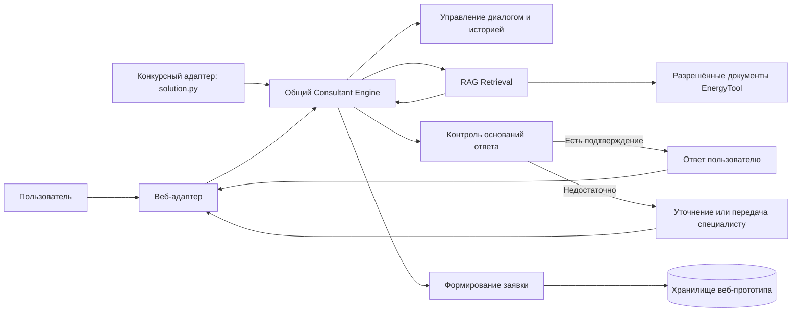

# Архитектура MTS EnergyTool AI Consultant

Документ описывает целевое направление. Компоненты пока не реализованы; решения, зависящие от проверки качества или конкурсной среды, обозначены как предварительные.

## Назначение и принцип

Консультант помогает представителю бизнеса подобрать направление EnergyTool и понять следующий шаг. Один основной **Consultant Agent** координирует специализированные компоненты; мультиагентная архитектура не вводится без подтверждённой потребности.

## Компоненты и потоки

Конкурсный и веб-адаптеры используют один общий Consultant Engine. Веб-адаптер представляет демонстрационный сценарий и предусматривает проектирование интеграции с сайтом МТС EnergyTool. Конкурсный запуск не требует frontend, backend-сервера или постоянной БД.

## RAG Retrieval

Предварительный pipeline: загрузка разрешённых документов EnergyTool → очистка и смысловое разбиение → подготовка BM25 и векторного представления (embeddings) → объединение кандидатов гибридным поиском → опциональный reranking → передача релевантных фрагментов LLM.

Ответ формируется только в пределах подтверждённых фрагментами сведений. Если найденных материалов недостаточно, агент:

1. задаёт конкретный уточняющий вопрос, когда недостаёт пользовательских вводных;
2. сообщает, что в доступных материалах нет подтверждённого ответа, если уточнение не устранит пробел;
3. не подставляет догадки и не представляет неподтверждённые сведения как факт.

Порог релевантности, размер фрагмента, число кандидатов и параметры объединения поиска не фиксируются до экспериментов.

## Диалоговые сессии

Веб-прототип должен сохранять контекст внутри каждой сессии, поддерживать смену темы и возврат к предыдущей теме, изолировать историю сессий и сохранять историю всех сессий, в том числе без заявки. Действие «Новый диалог» создаёт новую сессию без предыдущего контекста. Механизм хранения, срок хранения, доступ и удаление данных требуют отдельного определения до реализации.

В конкурсной автоматической оценке каждый ID является независимым тест-кейсом. История, вложенная в текст одного вопроса, применяется только к нему; состояние одного ID не переносится на другой.

## Формирование заявки

Заявка создаётся внутри демонстрационного прототипа; подключение к CRM не требуется. Обязательные поля: ФИО, телефон, название компании и краткое резюме диалога. Компонент собирает недостающие поля в разговоре и формирует структурированный черновик. В рамках хакатона используются только тестовые или выдуманные персональные данные; доступ к заявкам и правила локального хранения следует определить до реализации.

## Независимые точки использования

### Competition Runtime

Точка входа — `solution.py` в корне конкурсного ZIP. Runtime самостоятельно обрабатывает переданные вопросы и `knowledge-base.zip`, обращается к прокси модели, доступному в окружении проверки, и создаёт `submission.csv`. Вложения веб-сервера и постоянной базы данных в этом контуре нет. Строгий контракт указан в [COMPETITION.md](COMPETITION.md).

### Демонстрационное веб-приложение

Веб-прототип позволяет вести сессии, начать новый диалог, вернуться к контексту, передать вопрос специалисту и оформить заявку; также проектируется интеграция с сайтом. Предварительно рассматриваются API на FastAPI и интерфейс React/TypeScript; эти решения не являются подтверждёнными обязательными требованиями организаторов.

## Открытые вопросы

- Каковы экспериментально обоснованные настройки гибридного поиска и критерий достаточности контекста?
- Какой срок хранения истории и заявок и какая модель доступа подходят для демонстрационного прототипа?
- Каким способом представить интеграцию с сайтом в финальном сценарии, учитывая, что реальное подключение не требуется?
- Каким образом в интерфейсе передавать вопрос специалисту без реальной интеграции с CRM, сайтом или почтой?
