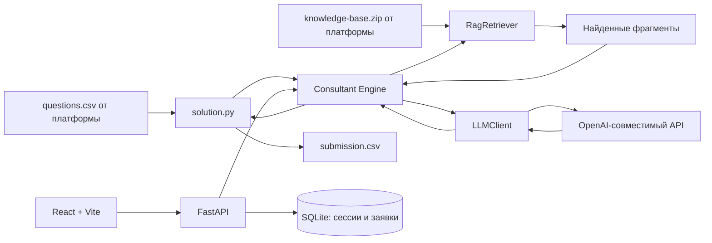

# Архитектура MTS EnergyTool AI Consultant

## Назначение и статус

Проект содержит конкурсный Python-адаптер и отдельный веб-прототип для демонстрации консультации. Веб-прототип не подключён к рабочему сайту МТС или CRM. Конкурсный адаптер запускается независимо от веб-сервера, базы данных приложения и React-клиента.

## Компоненты и потоки

Оба адаптера используют общий `ConsultantEngine`. Конкурсный `solution.py` разбирает входные строки, передаёт историю соответствующего ID движку и формирует `submission.csv`. Веб-путь проходит через FastAPI и сохраняет отдельные сессии и заявки в SQLite.

## Consultant Engine и RAG

Движок формирует поисковый запрос из последней реплики и релевантной истории, получает `RetrievedChunk` с текстом, источником и оценкой, затем передаёт найденные фрагменты в запрос модели как данные. При пустом поиске или ошибке модели используется безопасный ответ. Источники и время ответа доступны веб-API для диагностики.

`RagRetriever` строит BM25 по Markdown- и TXT-файлам. По настройке он добавляет плотный поиск через embeddings и перестановку кандидатов через reranker. Ошибки этих дополнительных каналов не должны лишать систему результатов BM25. Если основной RAG-модуль недоступен, Consultant Engine может использовать совместимый BM25-поиск.

LLM-клиент использует переменные окружения и OpenAI-совместимый протокол. Конкурсная платформа передаёт адрес прокси, служебный ключ и идентификатор модели; локальный `.env` нужен только для запуска разработчиком и не входит в Git.

## Данные и хранение

- В конкурсном запуске платформа отдельно предоставляет `questions.csv` и `knowledge-base.zip`; их не включают в ZIP решения. Индекс строится при запуске и остаётся в памяти процесса.
- В веб-прототипе база знаний подключается локально как read-only источник. Документы не копируются в Docker-образ.
- SQLite используется только веб-прототипом. Конкурсный runtime не зависит от этой БД.
- Заявка хранится в веб-прототипе только после явного согласия пользователя. Реальная отправка в CRM не реализована.

## Ограничения текущего прототипа

- Контекст и источники передаются модели, но система не проверяет каждое утверждение ответа отдельным валидатором. Качество grounding требует ручной проверки на выборке.
- Нет production-интеграции с сайтом МТС, CRM или почтой.
- Проверки CI используют mocks и синтетические данные; они не подтверждают доступность конкурсного API.
- Сборка Docker и сквозной пользовательский сценарий не проверены в текущей среде: Docker Engine недоступен.

Форматы конкурсного запуска описаны в [COMPETITION.md](COMPETITION.md), контракт веб-API — в [API.md](API.md), поведение движка — в [ENGINE.md](ENGINE.md), retrieval — в [RAG.md](RAG.md).
