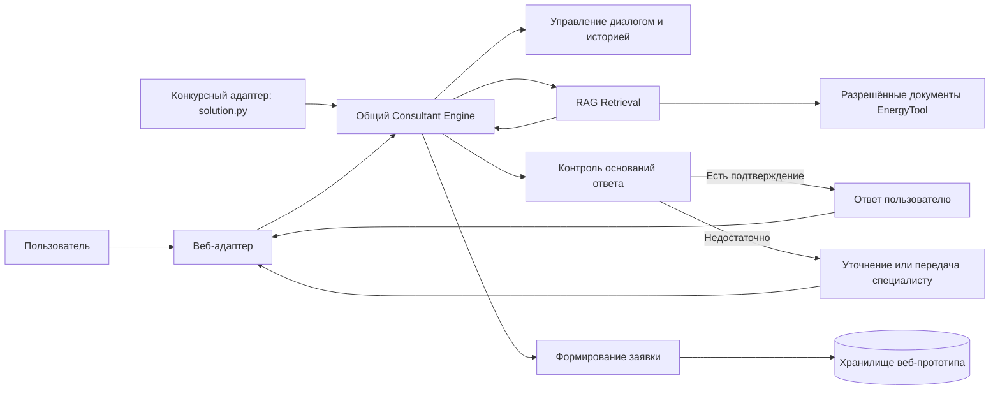

# Архитектура MTS EnergyTool AI Consultant

Это целевая схема, а не описание готовой системы. Компоненты ещё не реализованы. Настройки, зависящие от замеров и среды конкурса, остаются предварительными.

## Назначение и принцип

**Consultant Agent** помогает представителю бизнеса выбрать решение EnergyTool и понять, что делать дальше. Он обращается к компонентам поиска, диалога и заявок. Пока нет причины делить работу между несколькими агентами.

## Компоненты и потоки

Оба адаптера обращаются к одному Consultant Engine. Веб-адаптер обслуживает демонстрационный сценарий; для него нужно спроектировать интеграцию с сайтом МТС EnergyTool. Конкурсный запуск обходится без frontend, backend-сервера и постоянной БД.

## RAG Retrieval

RAG pipeline планируется так: загрузить разрешённые документы EnergyTool, очистить и разбить их по смыслу, построить BM25 и векторный индекс, объединить результаты поиска и при необходимости применить reranking. В LLM передаются найденные фрагменты.

Консультант отвечает по найденным фрагментам. Если их недостаточно, он:

1. задаёт конкретный уточняющий вопрос, когда недостаёт пользовательских вводных;
2. сообщает, что в доступных материалах нет подтверждённого ответа, если уточнение не устранит пробел;
3. не подставляет догадки и не представляет неподтверждённые сведения как факт.

Порог релевантности, размер фрагмента, число кандидатов и параметры объединения поиска не фиксируются до экспериментов.

## Диалоговые сессии

Веб-прототип сохраняет историю отдельно для каждой сессии. Пользователь может сменить тему, вернуться к прежней или начать «Новый диалог» без старого контекста. История сохраняется и для разговоров без заявки. До реализации нужно определить срок хранения, доступ и удаление данных.

В конкурсной проверке каждый ID обрабатывается отдельно. Если вопрос содержит историю, она относится только к этому ID.

## Формирование заявки

Заявка формируется в демонстрационном прототипе, без CRM. В ней нужны ФИО, телефон, название компании и краткое резюме разговора. Консультант запрашивает недостающие данные и собирает черновик. Для хакатона используйте только тестовые или выдуманные персональные данные. До реализации определите, кто видит заявки и как долго они хранятся.

## Независимые точки использования

### Competition Runtime

В корне конкурсного ZIP лежит `solution.py`. Платформа передаёт ему вопросы и `knowledge-base.zip`; скрипт обращается к прокси модели и создаёт `submission.csv`. Веб-сервер и постоянная база данных для этого запуска не нужны. Формат подробно описан в [COMPETITION.md](COMPETITION.md).

### Демонстрационное веб-приложение

Веб-прототип даст возможность вести сессии, начинать новые диалоги, возвращаться к прежней теме, передавать вопрос специалисту и оформлять заявку. Также нужно спроектировать его интеграцию с сайтом. Для API и интерфейса пока рассматриваются FastAPI и React/TypeScript; организаторы их не требуют.

## Открытые вопросы

- Каковы экспериментально обоснованные настройки гибридного поиска и критерий достаточности контекста?
- Какой срок хранения истории и заявок и какая модель доступа подходят для демонстрационного прототипа?
- Каким способом представить интеграцию с сайтом в финальном сценарии, учитывая, что реальное подключение не требуется?
- Каким образом в интерфейсе передавать вопрос специалисту без реальной интеграции с CRM, сайтом или почтой?
